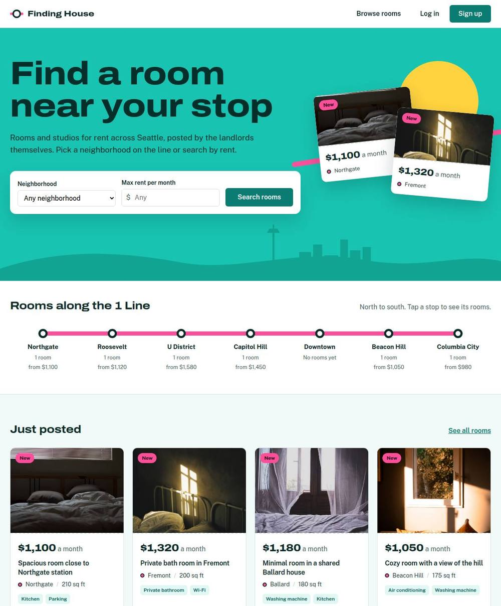
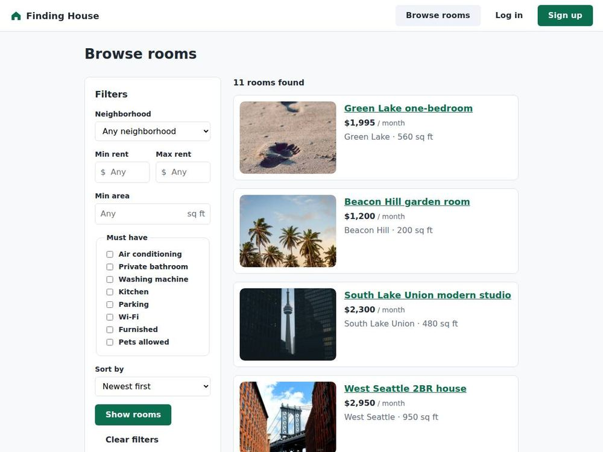
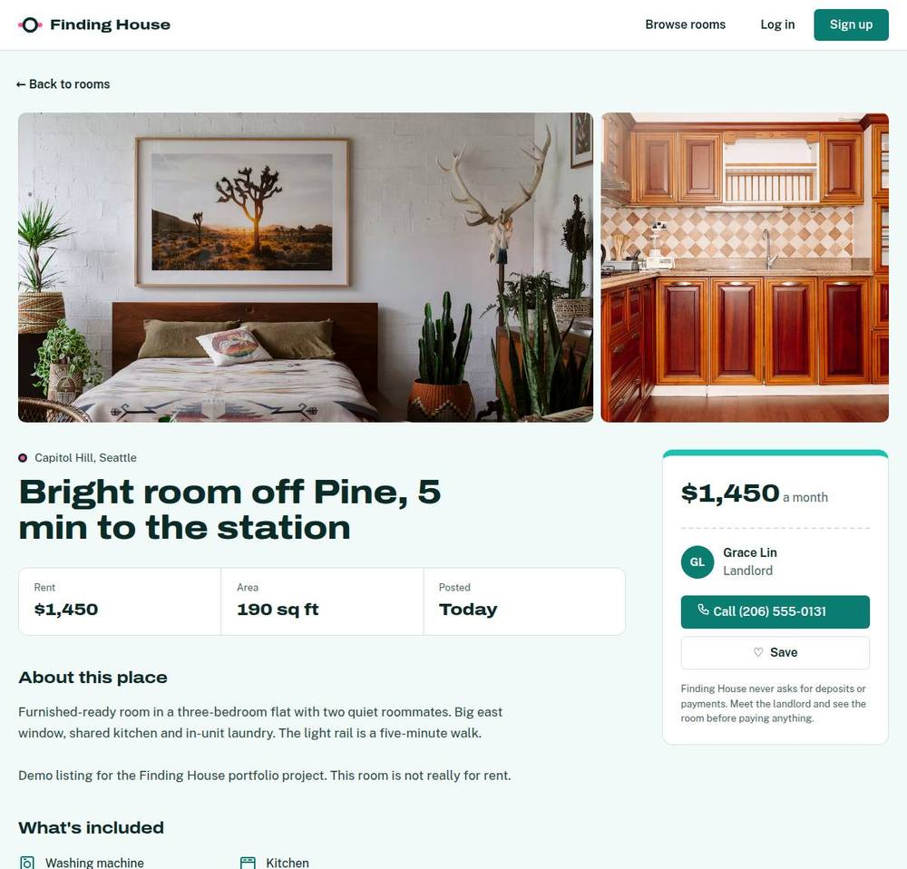
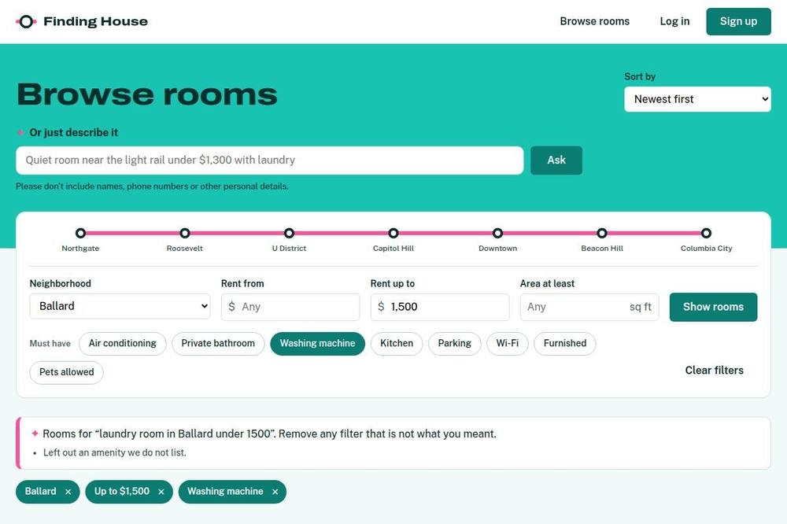
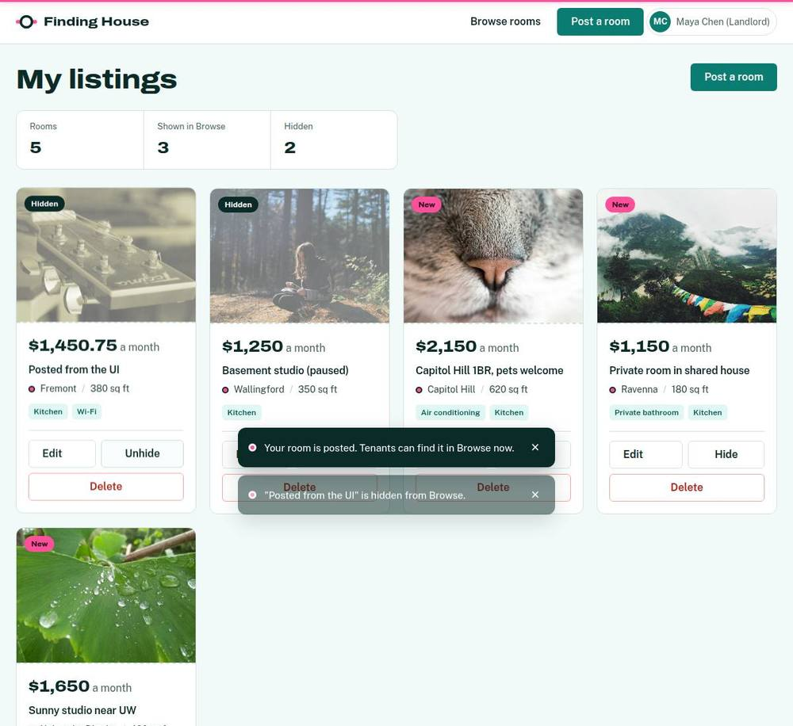
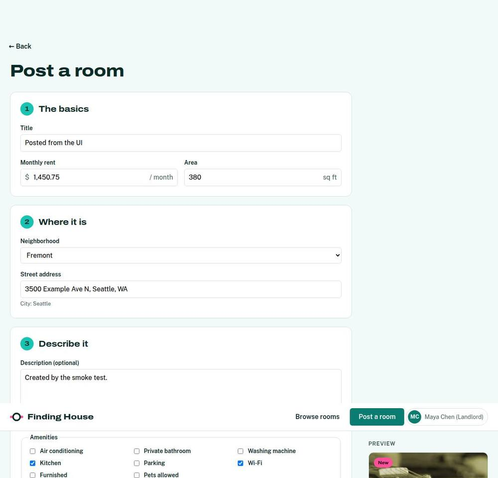
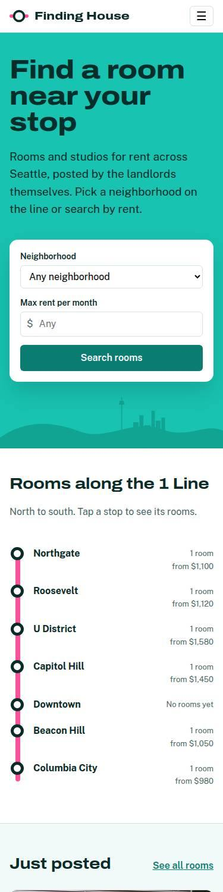
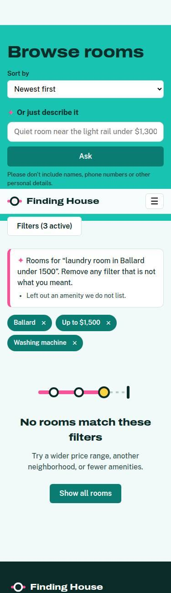
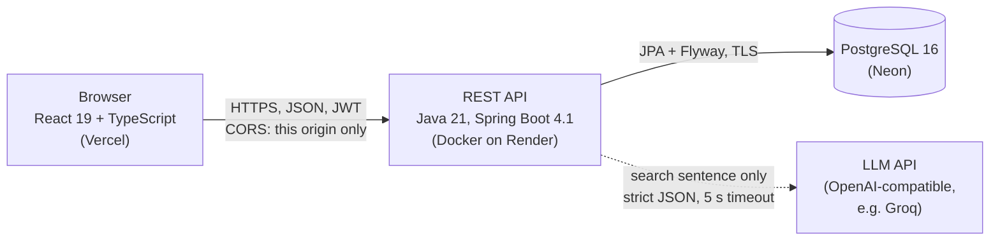

# Finding House

Rooms and studios for rent in Seattle: landlords post, tenants browse and filter. A full-stack portfolio project built with a documented engineering process.

**Live demo: [finding-house.vercel.app](https://finding-house.vercel.app)** · API: [finding-house.onrender.com](https://finding-house.onrender.com/actuator/health)

> The API runs on a free instance that sleeps after 15 idle minutes, so the first request can take about a minute. Current progress: [docs/STATUS.md](docs/STATUS.md).

| Home: rooms along the 1 Line | Browse with filters |
| --- | --- |
|  |  |
| **Listing page** | **AI search: words become filters** |
|  |  |
| **Landlord: my listings** | **Landlord: post a room with a live preview** |
|  |  |

<p align="center">
  
  &nbsp;
  
</p>

_Screenshots are taken automatically by CI: the live site with its fictional demo rooms, and the AI search against a fake AI provider. Demo photos are from Unsplash ([credits](docs/DEMO-CONTENT.md#photo-credits))._

## What it does

**Working now**

- **Accounts:** sign up as a tenant or landlord, log in, stay logged in for the tab (JWT, 2-hour tokens). What each role can do is enforced by the API, not just hidden in the UI.
- **Landlords:** post, edit, hide/unhide, and delete rooms with up to 5 photo links, with a live preview while typing; My listings shows how many rooms are shown and hidden.
- **Everyone:** browse with filters for neighborhood, rent range, minimum area, and amenities; a 1 Line strip with real room counts per stop; three sort orders; the filters live in the URL so a search can be shared; every filter in use is a chip you can remove.
- **Listing page:** photo grid, amenities, the nearest 1 Line stations, and a contact card with the landlord's phone (a call bar on phones); hidden listings are visible only to their owner.
- **Tenants:** save rooms with the heart and find them under Saved rooms.
- **Feels finished:** a designed look ("along the line"), phone layouts checked at 375 px on every push, toasts, empty states, a progress line while the server answers, and a note when the free server is waking up.

**AI search (built, switched on per deployment)**

Type *"quiet room in Ballard under $1,500 with laundry"* and an LLM turns it into the same filters you could set by hand. The model's reply must follow a strict JSON schema whose neighborhoods and amenities are the only values the market knows; the server then checks every value again with the manual filters' rules, drops what does not fit with a note, and the browse page shows the result as chips you can remove. Only the sentence is sent, never logged. If the AI is off, slow, busy or confused, the page says so and the manual filters keep working. Limits keep it inside the provider's free tier. On the live site it turns on when an API key is configured; until then the box is hidden.

**Planned**

- Photo upload instead of photo links; moderation tools for a public site; an accuracy report for AI search on 30 example sentences (T-305).

## How it is built



| Layer | Technology |
| --- | --- |
| Frontend | React 19, TypeScript, Vite, React Router, Vitest + Testing Library |
| Backend | Java 21, Spring Boot 4.1, Spring Security (stateless JWT), Spring Data JPA, Flyway |
| Database | PostgreSQL 16 (Testcontainers in tests, Docker Compose locally, Neon in production) |
| Quality | JUnit 5, Testcontainers, Playwright smoke tests, Spotless, ESLint, Prettier, GitHub Actions |
| AI | Any OpenAI-compatible chat API (Groq proposed, D-035); JDK `HttpClient`, no SDK |
| Hosting | Vercel, Render, Neon, all on free tiers (D-029) |

**Engineering highlights**

- **Tests on every push:** 140 backend tests against a real PostgreSQL, 144 frontend tests, and a smoke workflow that builds the backend's Docker image, runs it with a 512 MB limit, and drives Chrome through about 50 checks on the production build: every page at 375 px, AI search against a fake provider (including timeouts, rate limits and broken replies), and the demo content's photos. A separate workflow checks the live site.
- **Measured performance:** with 10,000 listings, browse requests take 40.8 ms at the 95th percentile (target: under 500 ms). The query plans are printed in every build, and no index was added before measuring.
- **AI that cannot break search:** the model only proposes filters; strict schema, our own validation, visible removable chips, per-address and global limits under the free tier, and manual search that never depends on it (NFR-04).
- **Security:** BCrypt passwords; failed-login and sign-up limits per client address, taken only from a header the host sets, never from forgeable `X-Forwarded-For`; CORS limited to the exact frontend origin; Content Security Policy; security headers at the host; request size limit; no secrets in the repository.
- **Process:** requirements with acceptance criteria ([SRS](docs/SRS.md)), architecture and UML ([ARCHITECTURE](docs/ARCHITECTURE.md)), 35 recorded decisions ([DECISIONS](docs/DECISIONS.md)), one branch per task with evidence in [BACKLOG](docs/BACKLOG.md), and a report per sprint ([reports](docs/reports/)).
- **Built with an AI pair:** Claude wrote most of the code under the process above; every change was checked in CI and reviewed by me before reaching `main`.

## Documentation

| Document | What it covers |
| --- | --- |
| [AGENTS.md](AGENTS.md) | How contributors (human or AI) start work |
| [docs/SRS.md](docs/SRS.md) | Requirements and acceptance criteria |
| [docs/ARCHITECTURE.md](docs/ARCHITECTURE.md) | Architecture, UML, data model, API |
| [docs/DECISIONS.md](docs/DECISIONS.md) | Decision log |
| [docs/BACKLOG.md](docs/BACKLOG.md) | Tasks and sprints |
| [docs/STATUS.md](docs/STATUS.md) | Current checkpoint |
| [docs/reports/](docs/reports/) | Sprint reports |
| [docs/WORKFLOW.md](docs/WORKFLOW.md) | Branching, review, engineering profile |

## Setup and testing

### Backend

Prerequisites: Java 21 and Docker (for the local database and for integration tests). Maven is not needed: the Maven wrapper (`./mvnw`, or `mvnw.cmd` on Windows) downloads the pinned version, Maven 3.9.11, on first use.

> **Windows:** use `copy .env.example .env` instead of `cp`, generate the secret in PowerShell with `$b = New-Object byte[] 48; [Security.Cryptography.RandomNumberGenerator]::Create().GetBytes($b); [Convert]::ToBase64String($b)`, run Python as `py`, and keep the project outside OneDrive (e.g. `C:\dev\finding-house`) so `node_modules` and `target` are not synced.

```bash
cp .env.example .env            # then set JWT_SECRET (required): openssl rand -base64 48
docker compose up -d postgres   # local PostgreSQL 16 on port 5432
cd backend
./mvnw spring-boot:run          # API on http://localhost:8080
curl localhost:8080/actuator/health   # {"status":"UP"}
```

Try the auth API (FR-01):

```bash
curl -X POST localhost:8080/api/v1/auth/register -H 'Content-Type: application/json' \
  -d '{"email":"ana@example.com","password":"correct-horse","displayName":"Ana","role":"LANDLORD"}'
curl -X POST localhost:8080/api/v1/auth/login -H 'Content-Type: application/json' \
  -d '{"email":"ana@example.com","password":"correct-horse"}'      # returns accessToken
curl localhost:8080/api/v1/me -H "Authorization: Bearer <accessToken>"
```

Post a listing as a landlord (FR-02; price in US cents):

```bash
curl -X POST localhost:8080/api/v1/listings -H "Authorization: Bearer <accessToken>" \
  -H 'Content-Type: application/json' \
  -d '{"title":"Sunny studio near UW","monthlyPriceCents":165000,"areaSqft":420,
       "neighborhood":"University District","address":"4500 Brooklyn Ave NE",
       "amenities":["WIFI"],"imageUrls":["https://example.com/a.jpg"]}'
curl localhost:8080/api/v1/me/listings -H "Authorization: Bearer <accessToken>"
curl localhost:8080/api/v1/reference-data          # neighborhoods and amenities
```

Run the checks CI runs (format check, build, tests with a throwaway PostgreSQL container):

```bash
cd backend
./mvnw verify
./mvnw spotless:apply           # fix formatting if the check fails
```

### Sample data

[`scripts/sample-data/sample-data.json`](scripts/sample-data/sample-data.json) holds fictional test data with every field the API accepts: 5 users (3 landlords, 2 tenants), 12 Seattle listings (all amenities, 0–5 images, one hidden, one with a broken image link, one without images), and 8 invalid requests with their expected errors.

Load it into a running backend (Python 3, no extra packages):

```bash
python3 scripts/sample-data/load_sample_data.py                  # users + listings, safe to run twice
python3 scripts/sample-data/load_sample_data.py --check-invalid  # also checks the invalid examples
```

Then log in as `maya.landlord@example.com` / `sample-pass-maya` (other passwords are in the JSON file).

### Synthetic data (thousands of listings)

For load testing and for a browse page that feels full, the backend can generate synthetic listings itself (T-203, D-028). It only does this under the `dev` profile, and tops the database up to the number you ask for, so restarting does not add more:

```bash
cd backend
SPRING_PROFILES_ACTIVE=dev SYNTHETIC_LISTINGS=10000 ./mvnw spring-boot:run
# Windows PowerShell: $env:SPRING_PROFILES_ACTIVE="dev"; $env:SYNTHETIC_LISTINGS="10000"; .\mvnw.cmd spring-boot:run
```

Synthetic listings belong to 20 landlords at `synthetic.landlord.NN@example.invalid` that cannot log in, and every description starts with "Synthetic listing for development and testing." The same `SYNTHETIC_SEED` (default 42) always gives the same data. To remove them, recreate the local database: `docker compose down -v && docker compose up -d postgres`.

### AI search accuracy

Measured on 30 fixed sentences with the live model: every filter right for **29 of 30** (97%), including nicknames ("SLU", "near UW"), price formats ("1.5k"), Vietnamese and Spanish, and a prompt-injection attempt. Details and limits: [evaluation report](docs/reports/ai-eval-report.md).

### AI search (optional)

Without these settings AI search is off and the box is hidden. To try it locally with Groq (free plan), put a key in `.env` (never commit it):

```bash
AI_BASE_URL=https://api.groq.com/openai/v1
AI_MODEL=openai/gpt-oss-20b
AI_API_KEY=<your key>
AI_REASONING_EFFORT=low     # gpt-oss is a reasoning model; low is enough for reading filters
```

Optional: `AI_MAX_TOKENS` (default 1024, includes the model's hidden reasoning) and `AI_TIMEOUT` (default 5s).

Or run the fake provider the smoke test uses (no key, answers by keyword): `node scripts/smoke/fake-ai.mjs 9099` with `AI_BASE_URL=http://localhost:9099/v1`, any `AI_MODEL`, and any `AI_API_KEY`.

### Frontend

Pages: home (hero search, AI search box, the 1 Line strip, just posted), browse with filters and chips (`/browse`), sign up, log in, listing detail (`/listings/:id`), Saved rooms for tenants (`/my/saved`), and for landlords: My listings (`/my/listings`), Post a room (`/listings/new`), and Edit (`/listings/:id/edit`) with delete. Built from reusable components in `frontend/src/components` (D-023), in the Lagoon design (D-033).

Prerequisites: Node.js 22.

```bash
cd frontend
npm ci                          # exact versions from package-lock.json
npm run dev                     # http://localhost:5173, proxies /api and /actuator to the backend on :8080
```

The page shows "API is up" when the backend is running. Set `BACKEND_URL` to point the dev proxy elsewhere.

Checks CI runs:

```bash
npm run lint
npm run format:check            # npm run format to fix
npm test
npm run build                   # type check + production build
```

## Deployment

Free hosting on Neon, Render, and Vercel (D-029); step-by-step guide in [docs/DEPLOYMENT.md](docs/DEPLOYMENT.md).

## Verified

| What | How | Evidence |
| --- | --- | --- |
| Backend starts on Spring Boot 4.1.1, Flyway applies migration V1, `/actuator/health` returns UP | `mvn -B -ntp verify` on GitHub Actions (ubuntu-latest, Temurin 21, Testcontainers `postgres:16-alpine`) | Commit `4e5e9a3`, run 42069891558: 2 tests, 0 failures; Spotless clean; BUILD SUCCESS |
| Frontend lints, is Prettier-formatted, passes tests for the API health indicator (up / down / unreachable), and builds | `npm ci`, lint, format check, `npm test`, `npm run build` on GitHub Actions (ubuntu-latest, Node 22) | Commit `6d6721a`, run 42074077400: 3 tests passed; build OK |
| FR-01 register / login / `/me`: field validation, case-insensitive duplicate email → 409, BCrypt-only storage, identical 401 for wrong password and unknown email, 401 for missing / malformed / expired / foreign-key / foreign-issuer tokens, app refuses weak JWT secrets | 21 tests (Testcontainers PostgreSQL) via `mvn -B -ntp verify` on GitHub Actions | Commit `6b6f324`, run 42095282281: 21 tests passed; Spotless clean |
| FR-02 listing API: landlords create, edit, hide/unhide, and list their listings; tenants and other landlords get 403; field validation incl. https-only image links (max 5) and known Seattle neighborhoods | 30 new tests (19 integration over HTTP, 11 unit) via `mvn -B -ntp verify` on GitHub Actions | Commit `5d52800`, run 42098935164: 51 tests passed |
| FR-04 listing detail: public view with landlord name and phone (never email); hidden listings are 404 for everyone except the owner, with the same body as a missing listing | 6 integration tests over HTTP | Commit `32df262`, run 42105905522 (attempt 2): 57 tests passed |
| Sign-up, login/logout, session restore, and the listing detail page work in a real browser against the real backend: photos, placeholder for missing or broken photos, hidden listing visible only to its owner, mobile layout | 30 Vitest tests + `scripts/smoke/page-screenshots.mjs` (Playwright) in the `smoke` workflow, which also saves screenshots | Commits `c8f7187`; frontend run 42108090385, smoke run 42108682551 |
| Landlords post, edit, hide, and unhide listings in the browser; tenants and visitors cannot open landlord pages | 58 Vitest tests + smoke page checks that post a real listing through the UI | Commit `e2d2759`; frontend run 42110970580, smoke run 42111365352 |
| Failed logins are throttled (429 after 5 per email or 20 per address in 15 min); passwords over 72 bytes are a 400, not a 500 | 6 unit tests with a controllable clock + 8 integration tests | Backend run 42113180536: 69 tests passed |
| The production frontend runs under a Content Security Policy with no violations; an expired token logs the user out; runtime npm dependencies have no high/critical advisories | Smoke page checks on the production build; Vitest; `npm audit` gate | Frontend run 42115527137 (62 tests), smoke run 42115527225 |
| Landlords delete listings after confirming in a dialog; only owners can delete (403/404 otherwise); tokens last 2 hours | 5 backend integration tests, dialog and page tests, smoke deletes a listing through the UI | Backend run 42122526491; frontend run 42123750933; smoke run 42123751179 |
| Back buttons, loading skeletons, avatar and mobile menus, footer, and the home carousel work in a real browser on the CSP build | 78 Vitest tests; 17 smoke page checks with screenshots | Frontend run 42123750933, smoke run 42123751179 |
| FR-03 browse API: price, neighborhood, area, and amenity filters combine; three sort orders; pagination with totals; invalid filters are field-level 400s; a page of results needs at most 5 SQL statements | 12 integration tests over HTTP | Commit `fb3c40f`, backend run 42128660324: 86 tests passed |
| Home page shows the newest real listings, hides hidden ones, and opens a listing from a slide; with the API down it shows a short message instead | Vitest home-page tests; smoke page checks 01 and 01b | Frontend run 42129758228 (84 tests); smoke run 42129758285 |
| Browse page: filters (neighborhood, rent range, area, amenities, sort) live in the URL, prices returned are within the range and in order, invalid filters are explained and not sent, pages of 12 | 16 Vitest tests; smoke checks 18–21 against the real API | Frontend run 42135480928 (100 tests); smoke run 42135480822 |
| NFR-02: with 10,000 listings, browse p95 is 40.8 ms (target < 500 ms) over 400 requests mixing every filter, sort, and deep pages | `BrowsePerformanceTest` (prints the latency table and query plans) | Backend run 42142023037 |
| Sample data loads through the real API (12 listings, 5 users), all 8 invalid examples are rejected with the expected status and field errors, and a second load creates no duplicates | `smoke` workflow, `load_sample_data.py --check-invalid`, then a second run | Commit `998031a`, run 42103027735: passed |
| The app runs as the README describes: `docker compose` PostgreSQL, backend with `.env`, API flow, and the page in a real browser shows "API is up" (and "API is down" when the backend stops) | `smoke` workflow: `scripts/smoke/api-smoke.sh` + headless Chromium via Playwright | Commit `504c909`, run 42096337624: all checks passed |
| Deployment edge: CORS allows only the configured frontend origin; per-address limits follow `CF-Connecting-IP` and ignore a forged `X-Forwarded-For`; bodies over 64 KB get 413; the backend Docker image runs within 512 MB | Integration tests in a deployment-like context; smoke builds and runs `backend/Dockerfile` and serves the production frontend from another origin | Backend run 42153629641; smoke runs 42153629649, 42154410160 |
| Sign-ups are limited to 10 attempts per address per hour (409 duplicates count); the page shows the wait time | Unit and integration tests; Vitest | Backend run 42154962043; frontend run 42154962010 |
| The live site: API health, CORS, host security headers (nosniff, X-Frame-Options, frame-ancestors, HSTS), CSP naming the API, SPA routing, and home and browse pages on desktop and phone with no CSP or CORS errors | `live-smoke` workflow against https://finding-house.vercel.app and https://finding-house.onrender.com | Run 42168599403 |
| Sprint 4 design on every page, checked in Chrome on desktop and at 375 px: home with real counts per 1 Line stop (new `GET /api/v1/neighborhoods`), browse with tickets and instant filters, listing page, landlord form with live preview, toasts, empty states, loading line and waking-up notice; no page scrolls sideways on a phone | Backend and Vitest tests; smoke page checks incl. `phone-shots.mjs` and a held API request | Backend run 42233683068; frontend run 42269788245; smoke run 42269787959; [Sprint 4 report](docs/reports/sprint-4-report.md) |
| Demo content: 16 photo links answer, accounts and 8 listings load through the API without a password in the repository, a second load creates nothing, and every photo renders; loaded on the live site by a manual workflow | `load_demo_data.py` in smoke with a throwaway password; `demo-data` workflow | Smoke run 42262894914; demo-data run 42324955711; live-smoke run 42325394120 |
| FR-05 AI search: only the sentence is sent, with a strict schema of known values; every value re-checked with the manual filters' rules; per-address and global limits; timeout, rate limit, provider errors and broken replies each give a clear message while manual search keeps working; in Chrome a sentence opens browse with removable chips | 19 backend tests against a fake provider; 5 Vitest tests; smoke `ai-search.mjs` with `fake-ai.mjs` on desktop and phone | Backend run 42330648718 (3 runs); frontend run 42329077479; smoke run 42329077496 |
| FR-06 favorites: saving twice keeps one entry, a hidden listing drops out and returns when shown, each tenant sees only their own list, hidden or missing listings cannot be saved, landlords and visitors cannot use it; in the browser a tenant saves, finds, and unsaves a room | 8 integration tests, 7 Vitest tests, smoke checks 23a/23b | Backend run 42169385441; frontend run 42169652230; smoke run 42169798299 |
