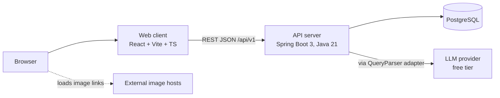
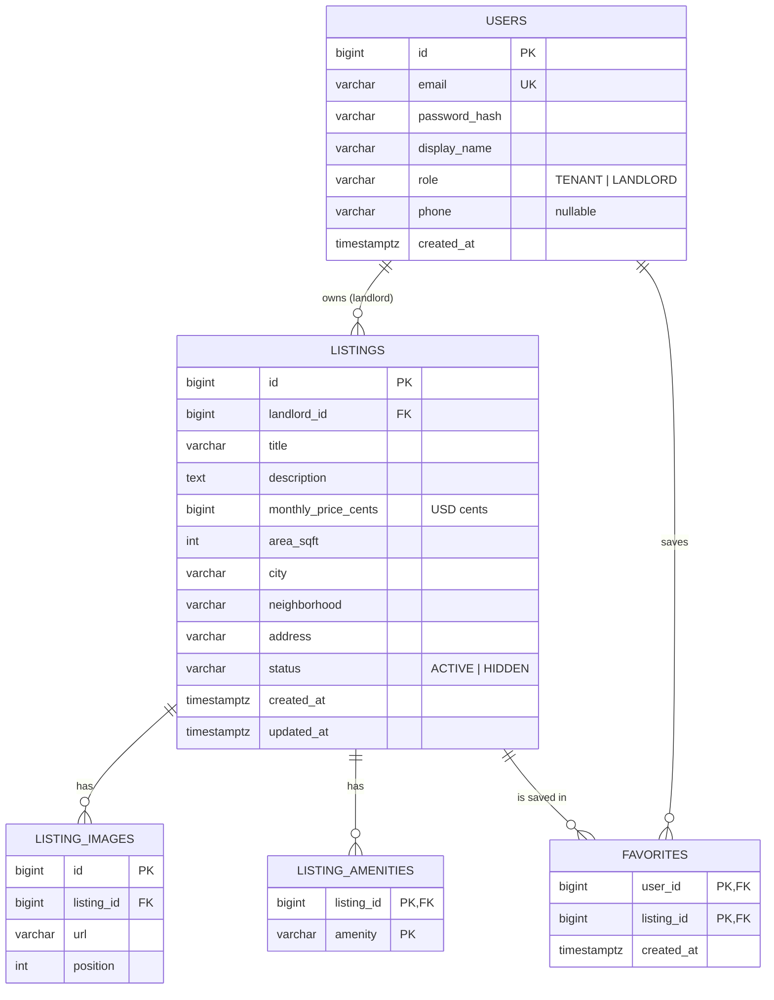
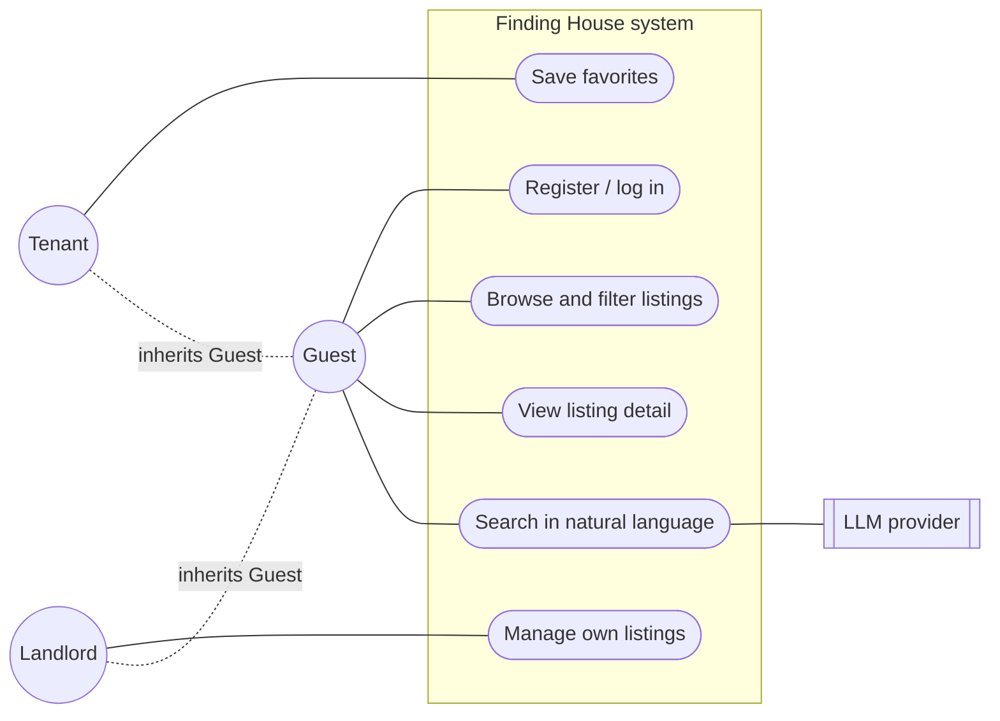
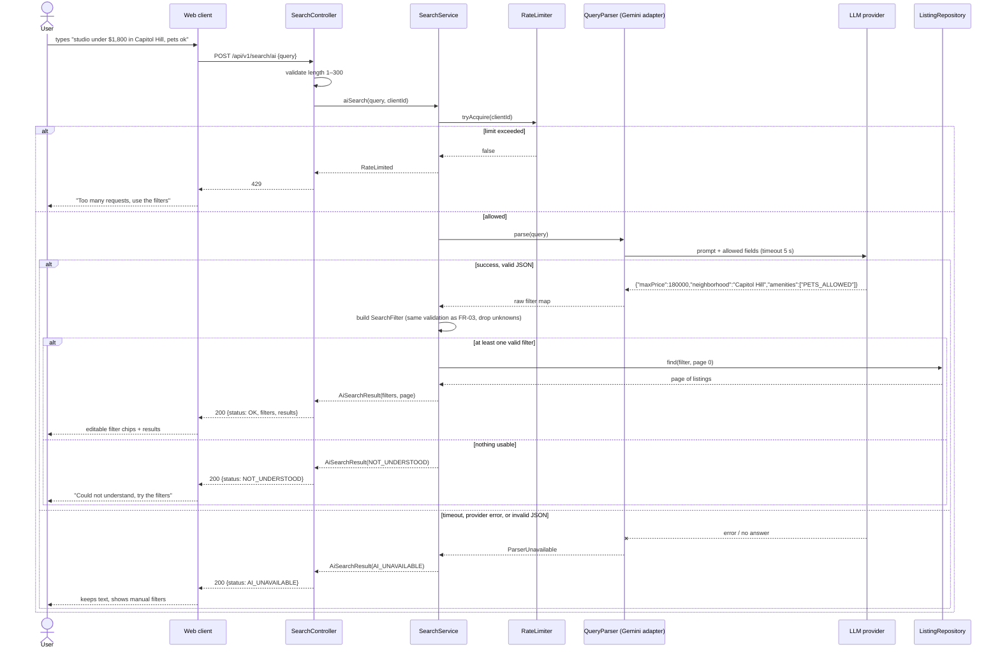

# Architecture — Finding House

| Field | Value |
| --- | --- |
| Version | 0.1 (Sprint 0 draft) |
| Status | **Proposed — awaiting baseline review** |
| Requirements baseline | [SRS.md](SRS.md) v0.1 |

All diagrams are Mermaid source embedded in this file. GitHub renders them, and this file is their single editable source under version control.

## 1. Overview and Rationale



**Selected style: layered monolith** (Controller → Service → Repository), organized by feature package. Rationale (ARCH-02):
- The product is mostly CRUD with one external integration. One deployable unit is the cheapest to build, test, and host for free.
- Layered architecture is the convention in Spring, so it is easy for a reviewer who is learning Java to follow.
- Business rules live in services, which can be unit-tested without HTTP or the database.

Rejected alternative: microservices. They add deployment, networking, and consistency costs with no benefit at this scale.

## 2. Components and Responsibilities

| Component | Responsibility | Owns |
| --- | --- | --- |
| Web client | Pages, forms, client-side convenience validation, display of AI-interpreted filters | UI state, access token in memory |
| `auth` package | Registration, login, token issuing and validation, current-user lookup | `User` |
| `listing` package | Listing CRUD, ownership checks, status transitions, image metadata | `Listing`, `ListingImage`, `ListingAmenity` |
| `search` package | Filter validation and query building (FR-03), AI search orchestration (FR-05), rate limiting | Filter rules |
| `ai` package | `QueryParser` interface and the LLM adapter: prompt, HTTP call, timeout, JSON parsing | Prompt template |
| `favorite` package | FR-06 | `Favorite` |
| `common` package | Error response format, configuration, security config | — |

**Dependency direction:** `controller → service → repository`. `search` depends on the `QueryParser` **interface**. The `ai` adapter implements that interface, so `search` never depends on a specific provider. No package depends on a controller.

**Where business rules live (ARCH-03):**
- Ownership and status rules: `ListingService`.
- Filter validity: `SearchFilter` (a value object) and `SearchService`. AI output goes through **the same validation** as manual filters.
- Framework coupling is limited to controllers (HTTP), repositories (JPA), and the adapter (HTTP client).

## 3. Design Patterns (ARCH-06)

| Pattern | Problem it solves | Simpler alternative considered | Tradeoff |
| --- | --- | --- | --- |
| Adapter (`QueryParser` → `GeminiQueryParser`) | The LLM is an external, slow, failure-prone, quota-limited service. Tests must not call it, and the provider may change (D-008). | Call the HTTP API directly inside `SearchService`. Rejected: makes FR-05 failure paths untestable without network. | One interface plus one implementation. A fake implementation is used in tests. |
| Value object (`SearchFilter`) | One validated representation of filters shared by manual and AI search, so AI output cannot bypass validation. | Pass raw request parameters around. Rejected: validation would be duplicated. | One small immutable class (a Java `record`). |

No other patterns are introduced. Spring's dependency injection supplies explicit constructor dependencies (ARCH-07).

## 4. Data Model



Schema changes are made only through Flyway migrations (CODE-11). Planned indexes: `listings(status, created_at)`, `listings(status, monthly_price)`, `listings(neighborhood)`. Each one will be checked against the NFR-02 measurement before it is kept (CODE-15).

## 5. API Overview

| Method | Path | Auth | Requirement |
| --- | --- | --- | --- |
| POST | `/api/v1/auth/register` | — | FR-01 |
| POST | `/api/v1/auth/login` | — | FR-01 |
| GET | `/api/v1/me` | any user | FR-01 |
| GET | `/api/v1/listings` | — | FR-03 |
| GET | `/api/v1/listings/{id}` | — (owner for hidden) | FR-04 |
| POST | `/api/v1/listings` | LANDLORD | FR-02 |
| PUT | `/api/v1/listings/{id}` | owner | FR-02 |
| PATCH | `/api/v1/listings/{id}/status` | owner | FR-02 |
| POST / DELETE | `/api/v1/listings/{id}/images[/{imageId}]` | owner | FR-02 |
| GET | `/api/v1/me/listings` | LANDLORD | FR-02 |
| POST | `/api/v1/search/ai` | — (rate-limited) | FR-05 |
| GET / PUT / DELETE | `/api/v1/me/favorites[/{listingId}]` | TENANT | FR-06 |

Errors use one JSON shape: `{ "code": "...", "message": "...", "fieldErrors": [...] }`. Stack traces and internal details are never returned (CODE-06).

## 6. Selected UML Views

Selected views and the reason for each (SRS readiness, §6 of the standard):

| View | Why it is included |
| --- | --- |
| Use case | Shows the three actors and the system boundary, including which actions need an account |
| Sequence: AI search | FR-05 is the riskiest interaction: external call, timeout, invalid output, rate limit |
| ER (§4) | The data model drives the migrations and the ownership rules |

Not included: class diagram (the domain is small and the ER plus §2 cover it) and state diagram (listing status has only two states, described in FR-02).

### 6.1 Use case

Mermaid has no native use-case diagram. This flowchart uses stadium shapes for use cases inside the system boundary.



### 6.2 Sequence: AI search (FR-05), including failure paths



Retry policy: **no automatic retry** on the LLM call. A retry would double the latency and use up the free quota, and the user can simply resubmit (CODE-09).

## 7. Cross-cutting Decisions

- **Authentication:** stateless JWT (Spring Security resource server with an HMAC key from an environment variable). Token lifetime is 24 h; there is no refresh token in the MVP. The client keeps the token in memory and `sessionStorage`. Tradeoff: simpler than httpOnly cookies, but exposed if an XSS bug exists. Mitigations: React escaping by default, no `dangerouslySetInnerHTML`. Recorded in D-009.
- **Rate limiting:** an in-memory token bucket per client IP. This is acceptable for one instance and is documented as a known limitation.
- **Configuration:** `application.yml` plus environment variables. `.env.example` is committed; `.env` is git-ignored.
- **Testability (ARCH-05):** the LLM is behind `QueryParser`, and time is injected via `java.time.Clock` where token expiry and timestamps matter.

## 8. Repository Layout (planned)

```
backend/     Spring Boot app (Maven), Flyway migrations in src/main/resources/db/migration
frontend/    React + Vite + TypeScript
docs/        SRS, architecture, decisions, backlog, status, sprints, standard
.github/workflows/  CI
docker-compose.yml  local PostgreSQL
```
